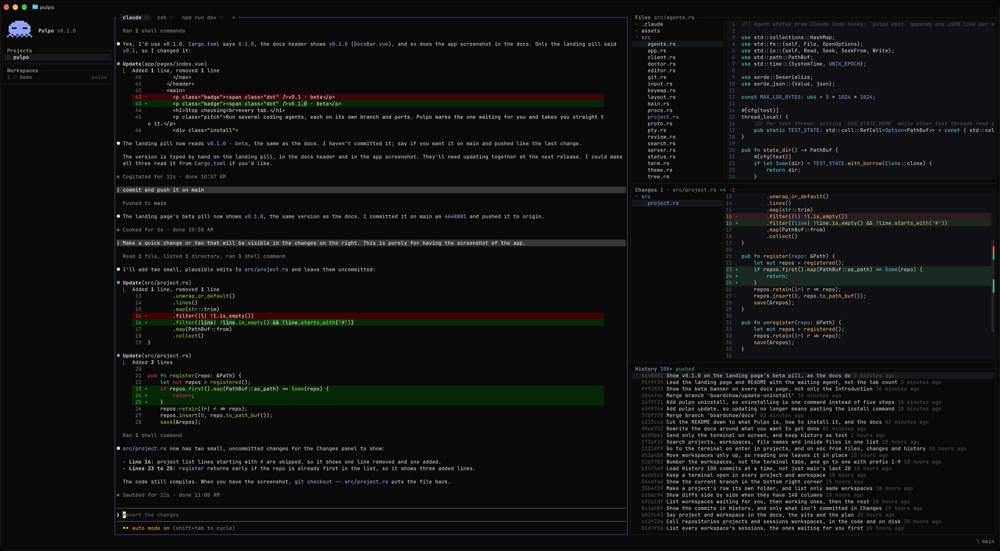

<p align="center">
  
</p>

<h1 align="center">Pulpo</h1>

<p align="center"><b>Stop checking every tab.</b></p>

Run several coding agents, each on its own branch and ports. Pulpo marks the one waiting for you and takes you straight to it.



## Install

```sh
curl -fsSL https://pulpo.sh/install | sh
```

Then run `pulpo` inside a git repository.

Pulpo needs macOS and runs in any terminal app. Claude Code lets Pulpo show what each agent is doing. See [Installation](https://pulpo.sh/docs/installation) for details.

## Docs

**[pulpo.sh/docs](https://pulpo.sh/docs)**

## Development

```sh
make run    # build and run Pulpo from this checkout
make test   # unit tests and the server's end-to-end test
```

How it's built: [PLAN.md](PLAN.md).

## License

[MIT](LICENSE)
