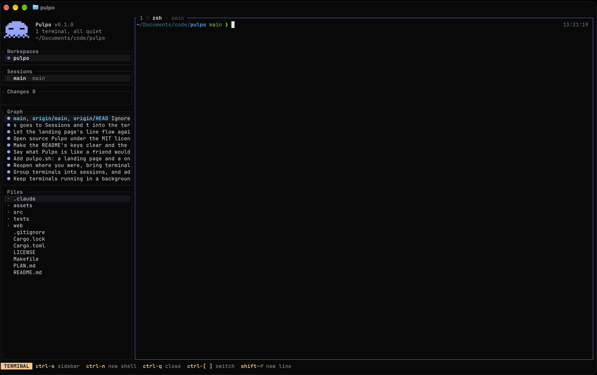

<p align="center">
  
</p>

<h1 align="center">Pulpo</h1>

<p align="center">
  
  
  
  
  
</p>

<p align="center"><b>Many agents. One terminal.</b><br>Spin up a few coding agents, give each its own copy of your repo,<br>and see who needs you. One terminal. Have fun :)</p>

<p align="center"><a href="https://pulpo.sh">pulpo.sh</a></p>

## Hey

So here's the thing.

I was running Claude Code in like five terminal tabs. One fixing a bug, one on a feature, one writing tests.

And tbh it was chaos.

Which tab is waiting on me? Why are two of them fighting over port 3000? Who changed this file??

So I built Pulpo.

It's a terminal multiplexer for coding agents. Think tmux, but it actually knows what your agents are up to.

- Every agent gets its own copy of your repo. Nobody steps on anybody.
- You see who's working and who's waiting on you.
- Files, diffs and the git graph sit right next to the terminals, so reviewing is easy.
- Quit whenever. The terminals keep running. Reboot, and they come back.

That's it. That's the app.

<p align="center">
  
</p>

## Install

```sh
curl -fsSL https://pulpo.sh/install | sh
```

One line. It installs whatever your Mac is missing (Xcode Command Line Tools, Rust), builds Pulpo and hooks it into Claude Code.

Run it again to update. Your running terminals won't even notice.

Building from a checkout? `make install`, then `pulpo hooks install` once.

## What you need

- A Mac. macOS only for now.
- [Ghostty](https://ghostty.org). It's what Pulpo is built and tested on. kitty, WezTerm and iTerm2 prob work too, no promises.
- [Claude Code](https://claude.com/claude-code). Other agents run fine inside, but Pulpo can't tell what they're doing unless they report it with [OSC 7501](https://mitchellh.com/writing/program-status-osc7501).

It's v0.1. Beta. Things will break. Tell me when they do.

## Using it

```sh
pulpo
```

Run it anywhere and you get your workspaces. Run it inside a git repo and it adds that one.

The sidebar on the left has your repos, sessions, changes and graph. The right side is where you work: terminal tabs, the file viewer, the editor. Your files are one key away: `f` shows them as a tree, and typing filters it.

It's made for the keyboard (clicking works too). The bottom bar shows the keys that work right where you are, and `?` shows all of them.

Jump around:

| Key | Goes to |
| --- | --- |
| `w` | Workspaces: your repos |
| `s` | Sessions: main and your task sessions |
| `c` | Changes: what's modified |
| `g` | Graph: the commits |
| `f` | Files: a tree, type to filter it (`tab` searches inside files) |
| `t` | the terminal of the current session (opens a shell if there's none) |

Make and do things:

| Key | Does |
| --- | --- |
| `n s` | new task session (its own copy of the repo) |
| `n t` | new terminal in this session (type `claude` in it) |
| `n w` | add a workspace (another repo) |
| `e` | edit the selected file (`ctrl-e` in the files) |
| `x x` | delete the selected session, drop a workspace from the list (files kept), or close the terminal (`ctrl-x` twice deletes a file in the files) |
| `q q` | quit; terminals keep running |
| `Q Q` | quit and stop every terminal |

Inside a terminal:

| Key | Does |
| --- | --- |
| `ctrl-s` | back to the sidebar |
| `ctrl-n` | new shell in the same session |
| `ctrl-[` `ctrl-]` | previous / next terminal |

## Sandboxes

This is the good part.

`n s` makes a task session: a full copy of your repo, in about a second. It's an APFS clone, so it takes no extra disk until files change. Kinda magic.

It has everything: your uncommitted work, your `.env`, your installed dependencies.

Start `claude` in it. Give it a job. Do it again.

One Claude on the bug. One on the feature. One on the tests. None of them can mess with the others.

If you use Docker Compose, each session also gets its own containers, its own ports and its own copy of the database. No more port 3000 fights lol. (The setup for each repo lives in `~/.config/pulpo/repos/<repo>.toml` if you wanna tweak it.)

Pulpo never runs git for you. The agents do the branches and commits, you just review.

Done with a task? `x x` deletes the session. It tells you first if you'd lose anything (uncommitted changes, unpushed commits).

## Close it. They keep going.

Hit `q` twice and go do something irl. Your agents, dev servers and long builds keep running.

The terminals live in a tiny background server. It only listens on a private Unix socket, never on the network.

Open Pulpo again and you're right where you left off. Reboot your Mac and Pulpo brings your terminals back and resumes your Claude sessions. Even updating Pulpo doesn't kill them.

When you actually want everything stopped: `Q` twice. It does it the polite way: Ctrl-C first, so dev servers free their ports and `docker compose up` stops its containers.

## Who needs you

Spinner next to a terminal: it's working.

`◆`: it's waiting for you.

And Ghostty pings you when an agent asks something or finishes. No more clicking through tabs to find the one that's been stuck for ten minutes.

This works through Claude Code's hooks. The installer sets them up. Built from a checkout, or installed Claude Code after Pulpo? Run:

```sh
pulpo hooks install   # adds them to ~/.claude/settings.json, rest of the file untouched
pulpo hooks status    # shows what's installed
pulpo hooks remove    # takes them out
```

## Editing

`e` opens the file right inside Pulpo. Same colors as the viewer, so what you see is literally what you edit.

Normal keys: shift to select, ctrl-c / x / v, ctrl-z, ctrl-f, ctrl-s to save, esc to close.

Rather use your own editor? All good:

```sh
export PULPO_EDITOR=nvim
```

## Hacking on it

```sh
make run    # build and run from the checkout
make test   # unit tests, and the server's end-to-end test
```

[PLAN.md](PLAN.md) explains how it's built and what's next. [web/](web) is [pulpo.sh](https://pulpo.sh) and the installer.

Wanna help? [CONTRIBUTING.md](CONTRIBUTING.md) has the short version.

## License

[MIT](LICENSE). Use it, fork it, ship it. Just keep the notice.
