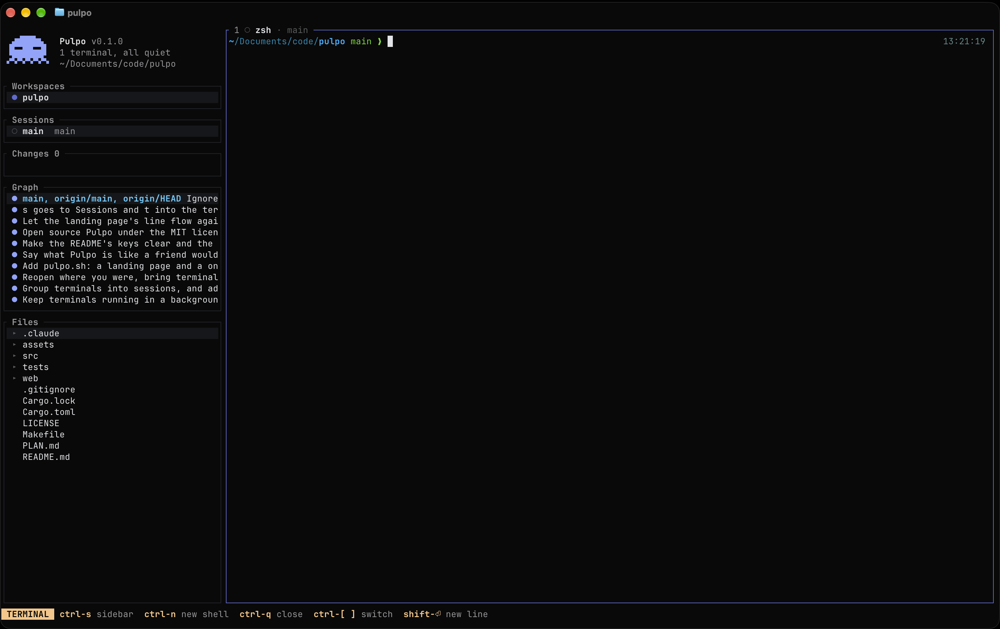

<p align="center">
  
</p>

<h1 align="center">Pulpo</h1>

<p align="center">
  
  
  
  
  
</p>

<p align="center"><b>Many agents. One terminal.</b><br>Spin up a few coding agents, give each its own copy of your repo,<br>and see who needs you. One terminal. Have fun :)</p>

<p align="center"><a href="https://pulpo.sh">pulpo.sh</a></p>

## Hey

So here's the thing.

I was running Claude Code in like five terminal tabs. One fixing a bug, one on a feature, one writing tests.

And tbh it was chaos.

Which tab is waiting on me? Why are two of them fighting over port 3000? Who changed this file??

So I built Pulpo.

It's a terminal multiplexer for coding agents. Think tmux, but it actually knows what your agents are up to.

- Every agent gets its own copy of your repo. Nobody steps on anybody.
- You see who's working and who's waiting on you.
- Files, diffs and the git graph sit right next to the terminals, so reviewing is easy.
- Quit whenever. The terminals keep running. Reboot, and they come back.

That's it. That's the app.

<p align="center">
  
</p>

## Install

```sh
curl -fsSL https://pulpo.sh/install | sh
```

One line. It installs whatever your Mac is missing (Xcode Command Line Tools, Rust), builds Pulpo and hooks it into Claude Code.

Run it again to update. Your running terminals won't even notice.

Building from a checkout? `make install`, then `pulpo hooks install` once.

## What you need

- A Mac. macOS only for now.
- [Ghostty](https://ghostty.org). It's what Pulpo is built and tested on. kitty, WezTerm and iTerm2 prob work too, no promises.
- [Claude Code](https://claude.com/claude-code). Other agents run fine inside, but Pulpo can't tell what they're doing unless they report it with [OSC 7501](https://mitchellh.com/writing/program-status-osc7501).

It's v0.1. Beta. Things will break. Tell me when they do.

## Using it

```sh
pulpo
```

Run it anywhere and you get your workspaces. Run it inside a git repo and it adds that one.

The sidebar on the left has the pulpo (with who's working or waiting), your repos, sessions, the session's tabs, changes and graph. The right side is where you work: tabs, each split into panes like tmux. A pane is a terminal, or the file pane (the viewer, or the editor in its place), which follows you to the tab you're on. Your files are one key away: `f` shows them as a tree, and typing filters it. `/` searches inside them.

It's made for the keyboard (clicking works too). The bottom bar shows the keys that work right where you are, and `?` shows all of them.

Jump around:

| Key | Goes to |
| --- | --- |
| `w` | Workspaces: your repos |
| `s` | Sessions: main and your task sessions |
| `c` | Changes: what's modified |
| `g` | Graph: the commits |
| `f` | Files: a tree, type to filter it |
| `/` | search inside files (`tab` switches with Files; in the viewer, `/` finds in the file) |
| `t` | the terminal of the current session (opens a shell if there's none) |

Make and do things:

| Key | Does |
| --- | --- |
| `n s` | new task session (its own copy of the repo) |
| `n t` | new tab with a shell in this session (type `claude` in it) |
| `n w` | add a workspace (another repo) |
| `e` | edit the selected file (`ctrl-e` in the files) |
| `x x` | delete the selected session, drop a workspace from the list (files kept), or close the terminal (`ctrl-x` twice deletes a file in the files) |
| `q q` | quit; terminals keep running |
| `Q Q` | quit and stop every terminal |

From anywhere, terminals included, Pulpo has a prefix: `ctrl-space` or `ctrl-b`, then one key. Same keys as Omarchy's tmux. Wait a beat after the prefix and a panel shows what can follow.

| Prefix, then | Does |
| --- | --- |
| `←` `↑` `→` `↓` | go to the pane that way (the sidebar is left of them all) |
| `shift` + arrows | swap with the pane that way |
| `alt` + arrows | move the border |
| `v` `h` | split: a shell beside or below |
| `L` | next layout: the pane you're in as the main one on the left, side by side, stacked, a grid, review (the diff of what the agent edits, on the right, following it) |
| `z` | zoom: the pane alone |
| `x` | close the pane (press it twice) |
| `c` | new tab with a shell |
| `1`-`9`, `p` `n` | tab N, previous / next |
| `r` `k` | rename the tab, close it (press it twice) |
| `[` | scroll back through the terminal: `j` `k` `u` `d` `g` `G` move, `/` finds (`n` `N` for the next), `v` selects, `y` copies, `q` back to now |
| `e` | hide or show the sidebar |
| `g` | go to: every agent and terminal, in every repo, with what it asks; type to filter, `tab` for which ones |
| `a` | the agent that has waited longest with something to read; again for the next |
| `tab` | back to the last tab or session |
| `space` | the menu: every action by name, with its key |
| `T` | theme: follow Ghostty's, Linear Dark, or any Ghostty theme; moving through the list tries each one |
| `B` | the board: every terminal of this repo, tiled, typing goes into the one you're in; again to go back |
| `S` | a swarm: `4 fix the flaky tests` makes four task sessions, starts Claude on that in each, and shows the board |
| `C` | new task session |
| `P` `N` | previous / next session |
| `K` | delete the task session (press it twice) |
| `W` | add a workspace |
| `d` | detach: quit, terminals keep running |
| `f` `/` | files, search inside files |
| `?` | every key; type to filter |
| the prefix again | sends it to the program |

With the mouse: drag the border between two panes, right-click for what can be done there, and ctrl-click a link to open it, or a path (`src/app.rs:120`, as agents print them) to see that line in the viewer.

And a few without the prefix:

| Key | Does |
| --- | --- |
| `ctrl-alt-←↑→↓` | go to the pane that way |
| `ctrl-alt-shift-←↑→↓` | move the border |
| `alt-1`-`9` | tab N |
| `alt-↑` `alt-↓` | previous / next session |

On a Mac, two things can get in the way. macOS switches keyboard layouts on `ctrl-space` when you have more than one (use `ctrl-b`, or turn that shortcut off), and Ghostty types `¡™£` for `alt-1`-`3` unless the left Option key is Alt. `pulpo doctor` checks both, and `pulpo doctor --fix` sets up Ghostty.

Want other keys? `~/.config/pulpo/keys.toml`:

```toml
prefix = ["ctrl-a"]
[after_prefix]
zoom = "m"
[chords]
tab_1 = "alt-a"
```

The old `ctrl-s`, `ctrl-n`, `ctrl-f`, `ctrl-q` and `ctrl-[` `ctrl-]` still work inside terminals for now, and say what replaces them. In the next release they go back to your programs (`legacy_ctrl_keys = false` does it today).

## Sandboxes

This is the good part.

`n s` makes a task session: a full copy of your repo, in about a second. It's an APFS clone, so it takes no extra disk until files change. Kinda magic.

It has your `.env` and your installed dependencies, and it starts from your last commit: uncommitted work stays where it was. Want to keep going on it instead? Make a branch right there.

Each session is its own git repo on the same branch main was on. Make a branch in it for the task. That branch lives only in that session until you push it, and the other sessions catch up with `git fetch` once it's merged.

Start `claude` in it. Give it a job. Do it again.

One Claude on the bug. One on the feature. One on the tests. None of them can mess with the others.

Or all at once: `ctrl-b S`, then `4 fix the flaky tests`. Four sessions, Claude on it in each, all on one board.

If you use Docker Compose, each session also gets its own containers, its own ports and its own copy of the database. No more port 3000 fights lol. (The setup for each repo lives in `~/.config/pulpo/repos/<repo>.toml` if you wanna tweak it.)

Besides starting a session clean, Pulpo never runs git for you. The agents do the branches and commits, you just review.

Done with a task? `x x` deletes the session. It tells you first if you'd lose anything (uncommitted changes, unpushed commits).

## Close it. They keep going.

Hit `q` twice and go do something irl. Your agents, dev servers and long builds keep running.

The terminals live in a tiny background server. It only listens on a private Unix socket, never on the network.

Open Pulpo again and you're right where you left off. Reboot your Mac and Pulpo brings your terminals back and resumes your Claude sessions. Even updating Pulpo doesn't kill them.

When you actually want everything stopped: `Q` twice. It does it the polite way: Ctrl-C first, so dev servers free their ports and `docker compose up` stops its containers.

## Who needs you

Spinner next to a terminal: it's working.

`◆`: it's waiting for you.

Next to the pulpo, the sidebar counts them for all your repos: click that, or `ctrl-b g`, to see which. `ctrl-b a` goes straight to the one that has waited longest.

And Ghostty pings you when an agent asks something or finishes. No more clicking through tabs to find the one that's been stuck for ten minutes.

This works through Claude Code's hooks. The installer sets them up. Built from a checkout, or installed Claude Code after Pulpo? Run:

```sh
pulpo hooks install   # adds them to ~/.claude/settings.json, rest of the file untouched
pulpo hooks status    # shows what's installed
pulpo hooks remove    # takes them out
```

## Colors

Pulpo wears your Ghostty theme, so it looks like the terminal around it. No theme in Ghostty: Linear Dark, Pulpo's own. `ctrl-b T` picks another: Omarchy's favorites first (Tokyo Night, Catppuccin, Gruvbox, Rosé Pine…), then yours, then all of Ghostty's. Move through them to try each one, `⏎` keeps it (in `~/.config/pulpo/config.toml`), `esc` puts the old one back.

## Editing

`e` opens the file right inside Pulpo. Same colors as the viewer, so what you see is literally what you edit.

Normal keys: shift to select, ctrl-c / x / v, ctrl-z, ctrl-f, ctrl-s to save, esc to close.

Rather use your own editor? All good:

```sh
export PULPO_EDITOR=nvim
```

## Hacking on it

```sh
make run    # build and run from the checkout
make test   # unit tests, and the server's end-to-end test
```

[PLAN.md](PLAN.md) explains how it's built and what's next. [web/](web) is [pulpo.sh](https://pulpo.sh) and the installer.

Wanna help? [CONTRIBUTING.md](CONTRIBUTING.md) has the short version.

## License

[MIT](LICENSE). Use it, fork it, ship it. Just keep the notice.
